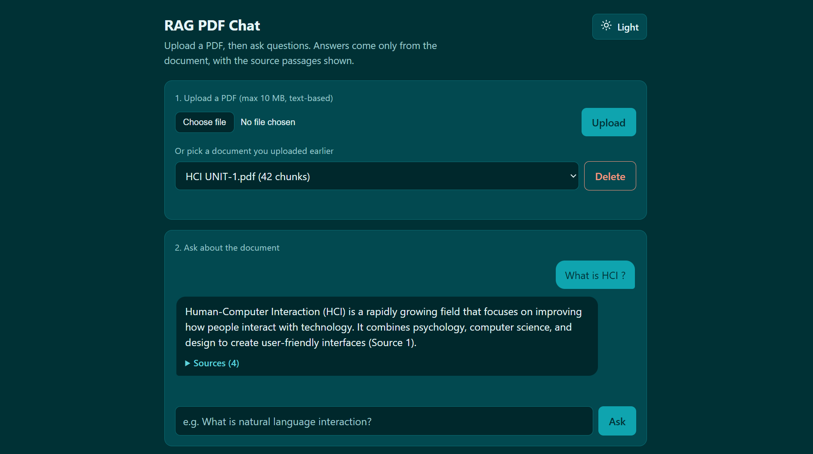
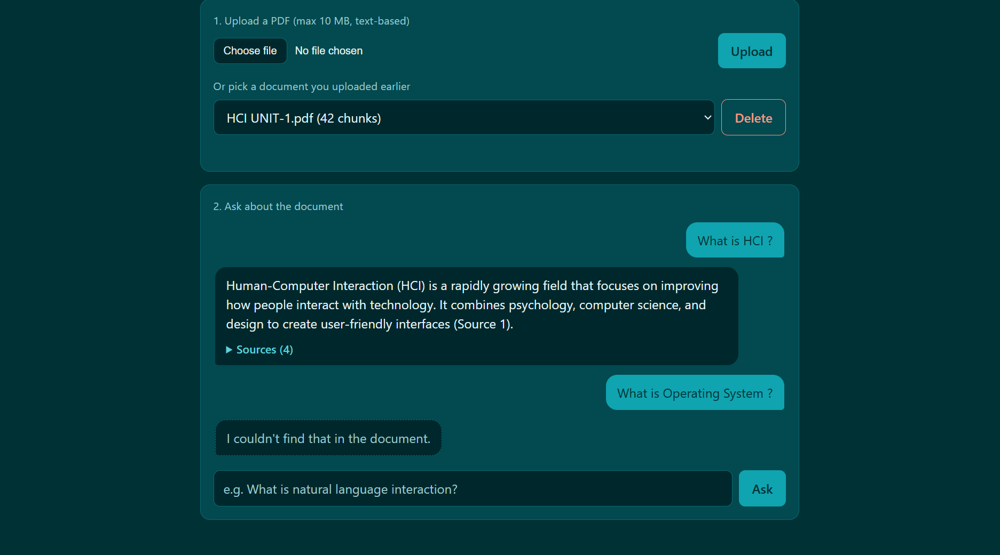

# RAG PDF Chat

Upload a PDF and ask questions about it. Answers come only from the document, with the source passages and page numbers shown. If the document doesn't contain the answer, the app says so instead of guessing.

**Live demo:** [click](https://rag-pdf-chat-3bsc.onrender.com/) (access code on request, see [Live demo notes](#live-demo-notes)). It also runs locally (see [Run locally](#run-locally)).




 


Built with Node.js, Express, the Gemini API and the Qdrant vector database. The retrieval pipeline (chunking, embeddings, similarity search, grounded prompting) is written by hand, with no LangChain, so every step is visible in [`rag.js`](rag.js) and [`qdrant.js`](qdrant.js).
 


## Live demo notes
 


- The demo is hosted on Render's free plan, so the first visit after a quiet period can take about a minute while the server wakes up.
- It is gated by a shared access code, checked by Express middleware before any API route runs. Ask me for the code. Please don't upload private files, because everyone with the code sees the same document list.
- It uses the free tier of the Gemini API, which has a small daily request limit. If the limit is reached, the app shows "The demo has reached its usage limit" and works again after the limit resets.

## Features
 
- Upload a text-based PDF (up to 10 MB) and chat with it in the browser
- Source citations on every answer (page number, similarity score and the exact passage), expandable in the UI
- "I couldn't find that in the document" instead of invented answers, with no sources shown in that case
- Documents are stored in Qdrant, so they survive server restarts
- Duplicate uploads are recognised by a fingerprint of the file's contents, so the same PDF is not embedded twice
- Delete a document from the page
- Friendly message when the Gemini free-tier limit is reached or the model is busy, instead of a generic error
- Unit tests that run offline, plus a test script for the Qdrant code

## How it works
 
**Uploading a PDF**
 
1. **Extract** the text of each page (`pdf-parse`), keeping page numbers
2. **Fingerprint** the file (SHA-256 of its bytes). If Qdrant already holds a document with that fingerprint, return it and stop
3. **Chunk** each page into ~800-character pieces with 150 characters of overlap, ending on sentence boundaries where possible. Chunks shorter than 10 characters (for example a page holding only a number) are skipped
4. **Embed** every chunk with Gemini (`gemini-embedding-001`, document mode), in batches of 50
5. **Store** each chunk in Qdrant as a point: its vector plus a payload of `docId`, `docName`, `fileHash`, `page`, `text`

**Asking a question**
 
1. **Embed** the question (query mode)
2. **Search** Qdrant for the 4 chunks closest in meaning, restricted to the selected document
3. **Prompt** Gemini to answer using only those chunks, or to reply with the exact "couldn't find" sentence
4. **Return** the answer with the source chunks, pages and scores (sources are left out when nothing relevant was found)

## Project structure
 
| File | What it does |
|---|---|
| `rag.js` | The RAG pipeline: PDF text extraction, chunking, embeddings, prompt building, answering. Also keeps the hand-written `cosineSimilarity` / `topK` retrieval as a tested reference |
| `qdrant.js` | Everything that talks to Qdrant: create the collection, save chunks, search, duplicate check, list, delete |
| `server.js` | Express API, file upload handling and the access-code check |
| `public/index.html` | The web page (plain HTML, CSS and JavaScript) |
| `public/favicon.svg` | The browser tab icon |
| `test-offline.js` | Unit tests that need no keys: chunking, cosine similarity, top-k, prompt building |
| `test-qdrant.js` | Tests `qdrant.js` against a real cluster with fake vectors, in a temporary collection that is deleted afterwards |
 
## Tech stack
 
Node.js 22.3 or newer, Express, Multer (uploads), pdf-parse, Gemini API (`@google/genai`) for embeddings and answers, Qdrant (`@qdrant/js-client-rest`) as the vector database, vanilla HTML/CSS/JS frontend. Deployed on Render (web service) with Qdrant Cloud.

## Run locally

1. Create a free cluster on [Qdrant Cloud](https://cloud.qdrant.io) and copy its URL and API key.
2. Get a Gemini API key from Google AI Studio.
3. Set up and start the app:
```bash
npm install
cp .env.example .env     # on Windows: copy .env.example .env
# edit .env and fill in the three values below
npm start                # open http://localhost:3000
```

`.env` settings:

| Variable | Required | Meaning |
|---|---|---|
| `GEMINI_API_KEY` | yes | Gemini API key |
| `QDRANT_URL` | yes | Your Qdrant cluster URL |
| `QDRANT_API_KEY` | yes (for Qdrant Cloud) | Qdrant API key |
| `ACCESS_CODE` | no | If set, every API call must send it in the `x-access-code` header (the page asks for it once per tab). Leave it unset for local use |
| `GEMINI_CHAT_MODEL` | no | Model that writes answers (default `gemini-3.1-flash-lite`) |
| `GEMINI_EMBED_MODEL` | no | Embedding model (default `gemini-embedding-001`) |
| `QDRANT_COLLECTION` | no | Collection name (default `pdf_chunks`) |
| `PORT` | no | Server port (default `3000`) |

Never commit `.env`. It is listed in `.gitignore`.

Tests:

```bash
npm run test:offline     # no keys needed
npm run test:qdrant      # needs QDRANT_URL and QDRANT_API_KEY
```

## API

| Endpoint | Body | Returns |
|---|---|---|
| `POST /upload` | multipart, field `pdf` (max 10 MB) | `{ docId, name, pages, chunks }`, or `{ docId, name, chunks, duplicate: true }` if the same PDF was uploaded before |
| `POST /chat` | `{ docId, question }` (question up to 6000 characters) | `{ answer, found, sources: [{ page, score, text }] }`, or 404 if the document does not exist |
| `GET /documents` | none | `[{ docId, name, chunks }]` |
| `DELETE /documents/:docId` | none | `{ ok: true }`, or 404 if the document does not exist |

When `ACCESS_CODE` is set, all four endpoints return 401 without the right `x-access-code` header. `/upload` and `/chat` return 429 with a friendly message when the Gemini quota is used up.

## Design decisions

- **Built by hand first, then moved to Qdrant.** The original retrieval (embeddings plus a cosine-similarity scan in memory) is still in `rag.js` and unit-tested. The app now uses Qdrant for storage and search, which adds persistence and scales past what an in-memory array can hold.
- **One collection, filtered by document.** All chunks live in a single collection, each tagged with its `docId`. A question searches only the selected document through a filter on `docId`, which is indexed. The collection uses cosine distance with 3072 dimensions, Gemini's default embedding size.
- **Duplicate detection by content hash.** The SHA-256 of the uploaded file is stored with each chunk (and indexed). A repeat upload is recognised even if the file was renamed, and costs no embedding calls.
- **Separate embedding modes.** Documents and questions are embedded with different task types (document and query), which the embedding model is tuned for.
- **Grounding by prompt and by UI.** The prompt restricts the model to the retrieved context and gives it an exact sentence to use when the answer is missing. The interface shows the passages used so answers can be checked.
- **Batching.** Embeddings are requested 50 chunks at a time and Qdrant writes happen 25 points at a time, because each vector has 3072 numbers.
- **Small access gate instead of full auth.** A shared access code, read from an environment variable and checked in Express middleware, keeps the public demo from being used by strangers or bots. Error details are logged on the server and not sent to visitors.

## Known limitations

- **No per-user accounts.** Access is controlled by one shared code, so everyone who has it sees, and can delete, every document, and the server cannot tell users apart. There is also no per-user rate limiting. Before wider public use it needs user accounts (for example an owner id in each payload, filtered on every request) and rate limits to protect the API quotas.
- **Free-tier limits.** Gemini's free tier allows only a small number of answers per day, and Render's free service sleeps when idle.
- The document list is built by scanning chunk payloads. That is fine for a handful of documents; a larger app would keep a separate record per document.
- A free Qdrant Cloud cluster is suspended after about a week without use and deleted after four weeks of inactivity (per Qdrant's documentation), so stored documents are only kept while the app is used.
- Duplicate detection matches identical file contents only. A re-saved or re-exported PDF counts as a new document.
- Each question is answered independently, with no conversation memory.
- Scanned (image-only) PDFs are not supported because there is no OCR. Tables and figures are read as plain text.
- Similarity scores alone don't prove relevance (unrelated questions still score around 0.6), so the prompt instruction is what prevents off-topic answers.
- Only the top 4 chunks are used, so answers that need information spread across many pages can be incomplete.

## Possible next steps

User accounts with per-user documents, conversation memory for follow-up questions, reranking of retrieved chunks, streaming answers, OCR for scanned PDFs, and a separate document-metadata record.